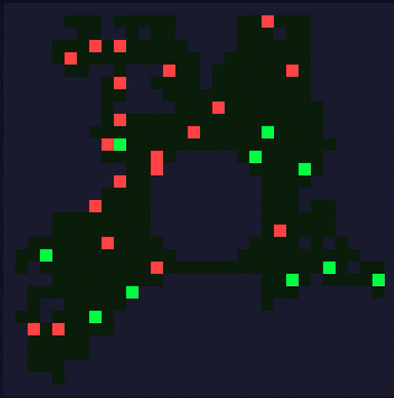
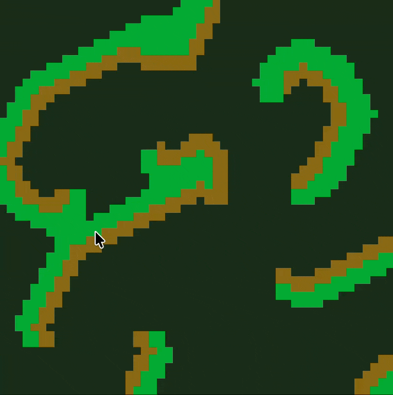
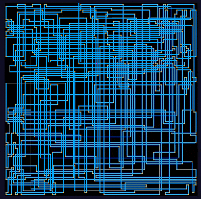
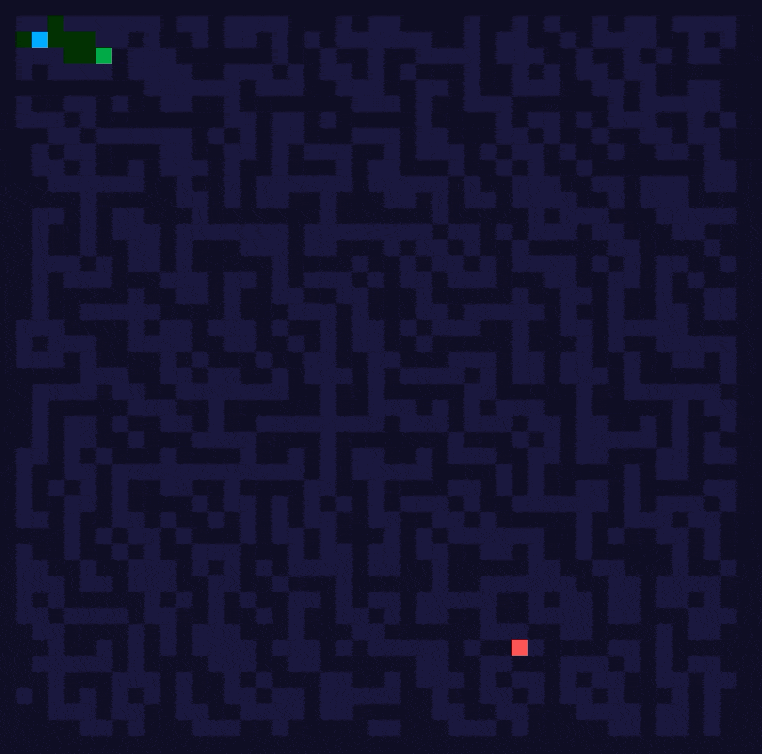

# AoC Portfolio

A visual Advent of Code portfolio — browse solutions by year and day, read write-ups, view syntax-highlighted code, and run solutions against your own puzzle input directly in the browser. No server required; Python runs via [Pyodide](https://pyodide.org) (WebAssembly).

Deployable to GitHub Pages with zero configuration.

## Motivation 

I have been a long-time AOC enthusiast, and this project will be the one to combine them all. Where I initially solve the puzzles myself, AI is used to provide feedback, improve them, and generate the visualization. Overall, creating a pleasing and interesting portfolio of problems. 

## Example Visualizations

### 2018 - Day 15



### 2018 - Day 18



### 2017 - Day 15


### 2017 - Day 19



### 2016 - Day 13



### 2015 - Day 18


## Structure

```
solutions/
  template/          ← copy this when adding a new solution
  2024/
    day01/
      solution.py    ← implements solve() and optionally visualize()
      meta.json      ← title, description, write-up, tags, stars
frontend/            ← Vite + React + TypeScript + Tailwind CSS
.github/
  workflows/
    deploy.yml       ← auto-deploys to GitHub Pages on push to main
Makefile
```

## Getting started

```bash
make install   # install npm dependencies (one-time)
make dev       # start dev server at http://localhost:5173
make build     # production build → frontend/dist/
```

## Adding a solution

Scaffold from the template:

```bash
make new YEAR=2024 DAY=05
```

This copies `solutions/template/` into `solutions/2024/day05/`. Then edit the two files:

**`solution.py`** — implement `solve()` which returns a `(part1, part2)` tuple:

```python
def solve(puzzle_input: str) -> tuple[str, str]:
    lines = puzzle_input.strip().split("\n")
    # ...
    return str(part1), str(part2)
```

Optionally add `visualize()` to enable the Visualization tab:

```python
def visualize(puzzle_input: str):
    # Grid frame — renders as a pixel canvas
    yield {
        "type": "grid",
        "cells": [list(row) for row in lines],
        "colors": {"#": "#00ff41", ".": "#0f0f23"},
        "delay": 100,  # ms between frames
    }

    # Text frame — renders as monospace text
    yield {
        "type": "text",
        "lines": ["Step 1", "Running total: 42"],
        "delay": 300,
    }
```

**`meta.json`** — metadata shown in the UI:

```json
{
  "title": "Historian Hysteria",
  "description": "One-line description.",
  "writeup": "## Approach\n\nMarkdown write-up here.",
  "tags": ["sorting", "Counter"],
  "stars": 2
}
```

`stars` is `0` (not started), `1` (part 1 done), or `2` (both parts done).

## Testing locally

Use `run.py` to test solutions from the command line — faster feedback than the browser.

```bash
python3 run.py 2024 1                        # reads from inputs/2024/day01.txt or stdin
python3 run.py 2024 1 -i path/to/input.txt  # explicit input file
python3 run.py 2024 1 --viz                  # also step through visualize() frames
python3 run.py 2024 1 --viz --frames 20      # limit to N frames

# Or via Make:
make run YEAR=2024 DAY=01
make run YEAR=2024 DAY=01 VIZ=1
```

**Input file convention** — store your puzzle inputs in `inputs/YEAR/dayDD.txt` and the runner picks them up automatically, no flags needed:

```
inputs/
  2024/
    day01.txt
    day02.txt
```

The `inputs/` folder is gitignored — AoC asks you not to share puzzle inputs publicly.

## Daily workflow during the event

`aoc.py` covers the routine around solving a puzzle. `YEAR` and `DAY` default to today's puzzle (puzzles unlock at midnight US Eastern time), or pass them explicitly, for example `make check YEAR=2025 DAY=03`.

```bash
make today                   # scaffold the solution, download the input, create example files
make watch                   # re-run the check every time you save
make check                   # run solve() on the examples, then on the real input
make submit PART=1           # run on the real input and submit after a y/N prompt
make submit PART=2 FORCE=1   # submit even when an example fails
```

`make today` waits for the unlock if you start it early. Downloading and submitting use [advent-of-code-data](https://github.com/wimglenn/advent-of-code-data) (`pip install advent-of-code-data`), which reads your adventofcode.com session cookie from the `AOC_SESSION` environment variable or `~/.config/aocd/token`.

**Examples** are filled in by hand next to the real input. Paste the example from the puzzle text into `inputs/YEAR/dayDD.example.txt` (add `dayDD.example2.txt` and so on when part 2 uses a different one) and put the expected answers in `inputs/YEAR/dayDD.answers.json`:

```json
{
  "example": {"part1": "142", "part2": ""},
  "example2": {"part1": "", "part2": "281"}
}
```

An empty answer is not checked. While an example fails, the real input is skipped and `make submit` refuses to send anything unless you add `FORCE=1`. Run the tests of this tooling with `make test`.

## Shared helper library

`solutions/aoc_utils.py` holds reusable helpers for any year: parsing (`ints`, `lines`, `sections`), grids (`parse_grid`, `neighbors`, `DIRS_4`, `print_grid`, ...), search (`bfs`, `dijkstra` with optional A* heuristic, `shortest_path`, `regions`, `UnionFind`, `topological_sort`), math (`crt`, `state_after` for cycle skipping, `extrapolate`, `shoelace_area`, `solve_linear`) and ranges (`merge_intervals`, `subtract`, `total_length`). New solutions from the template already import the common ones.

Just write `from aoc_utils import ...`: the site detects the import, loads the file into Pyodide and shows it in the Code tab, and `run.py`, `aoc.py` and `run_all.py` put `solutions/` on the Python path. It is standard library only and tested by `make test`.

## Technique index

The **Techniques** page (`#/techniques`) groups all solutions by algorithm, with tips on how to recognise each technique in a puzzle, the best past solution to reread, and a short Python snippet. The techniques live in `frontend/src/data/techniques.json`; each one lists the `meta.json` tags that place a day under it, so tag new solutions with existing tags where possible. The snippets are plain Python files in `frontend/src/data/snippets/`, tested against puzzle examples by `make test`.

## Deploying to GitHub Pages

1. Enable Pages in your repo: **Settings → Pages → Source: GitHub Actions**
2. Push to `main` — the workflow builds the site and deploys it automatically

The GitHub Action sets `VITE_BASE_URL=/<repo-name>/` so all asset paths resolve correctly on GitHub Pages.

## How it works

- The Vite build scans `solutions/` at build time and generates a `solutions-manifest.json` index
- Solution `.py` files are served as static assets and fetched on demand
- Python execution uses [Pyodide 0.27](https://pyodide.org) loaded from CDN — first run downloads ~10 MB, after that it's cached
- Each solution runs in a fresh Python namespace so there are no side effects between runs
- `HashRouter` is used for client-side routing (required for GitHub Pages)
